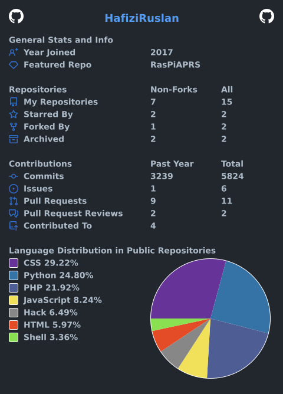

# Hi there 👋

<div style="text-align: center;">


<table style="margin-left: auto; margin-right: auto;">
  <tr><th colspan="2" style="text-align: center;">Repositories</th></tr>
  <tr><td style="text-align: end;">GitHub</td><td><a href="https://github.com/HafiziRuslan">HafiziRuslan</a></td></tr>
  <tr><td style="text-align: end;">Gist.GitHub</td><td><a href="https://gist.github.com/HafiziRuslan">HafiziRuslan</a></td></tr>
  <tr><td style="text-align: end;">GitLab</td><td><a href="https://gitlab.com/hafiziruslan">hafiziruslan</a></td></tr>
  <tr><td style="text-align: end;">Codeberg</td><td><a href="https://codeberg.org/hafiziruslan">hafiziruslan</a></td></tr>
  <tr><td style="text-align: end;">Gitea</td><td><a href="https://gitea.com/HafiziRuslan">HafiziRuslan</a></td></tr>
  <tr><td style="text-align: end;">WPSD-Dev</td><td><a href="https://repo.w0chp.net/9m2fzy">9M2FZY</a></td></tr>
</table>

</div>

## About

<div style="text-align: center;">









</div>

<!--
**HafiziRuslan** is a ✨ _special_ ✨ repository because its `README.md` (this file) appears on your GitHub profile.

Here are some ideas to get you started:

- 🔭 I’m currently working on ...
- 🌱 I’m currently learning ...
- 👯 I’m looking to collaborate on ...
- 🤔 I’m looking for help with ...
- 💬 Ask me about ...
- 📫 How to reach me: ...
- 😄 Pronouns: ...
- ⚡ Fun fact: ...
-->

<!--START_SECTION:waka-->


**🐱 My GitHub Data** 

> 📦 472.2 kB Used in GitHub's Storage 
 > 
> 🏆 2,673 Contributions in the Year 2026
 > 
> 💼 Opted to Hire
 > 
> 📜 15 Public Repositories 
 > 
> 🔑 4 Private Repositories 
 > 
**I'm a Night 🦉** 

```text
🌞 Morning                883 commits         ⣿⣿⣿⣿⣀⣀⣀⣀⣀⣀⣀⣀⣀⣀⣀⣀⣀⣀⣀⣀⣀⣀⣀⣀⣀   14.91 % 
🌆 Daytime                1066 commits        ⣿⣿⣿⣿⣀⣀⣀⣀⣀⣀⣀⣀⣀⣀⣀⣀⣀⣀⣀⣀⣀⣀⣀⣀⣀   18.00 % 
🌃 Evening                1723 commits        ⣿⣿⣿⣿⣿⣿⣿⣀⣀⣀⣀⣀⣀⣀⣀⣀⣀⣀⣀⣀⣀⣀⣀⣀⣀   29.10 % 
🌙 Night                  2249 commits        ⣿⣿⣿⣿⣿⣿⣿⣿⣿⣀⣀⣀⣀⣀⣀⣀⣀⣀⣀⣀⣀⣀⣀⣀⣀   37.98 % 
```
📅 **I'm Most Productive on Wednesday** 

```text
Monday                   932 commits         ⣿⣿⣿⣿⣀⣀⣀⣀⣀⣀⣀⣀⣀⣀⣀⣀⣀⣀⣀⣀⣀⣀⣀⣀⣀   15.74 % 
Tuesday                  1042 commits        ⣿⣿⣿⣿⣀⣀⣀⣀⣀⣀⣀⣀⣀⣀⣀⣀⣀⣀⣀⣀⣀⣀⣀⣀⣀   17.60 % 
Wednesday                1070 commits        ⣿⣿⣿⣿⣿⣀⣀⣀⣀⣀⣀⣀⣀⣀⣀⣀⣀⣀⣀⣀⣀⣀⣀⣀⣀   18.07 % 
Thursday                 1011 commits        ⣿⣿⣿⣿⣀⣀⣀⣀⣀⣀⣀⣀⣀⣀⣀⣀⣀⣀⣀⣀⣀⣀⣀⣀⣀   17.07 % 
Friday                   717 commits         ⣿⣿⣿⣀⣀⣀⣀⣀⣀⣀⣀⣀⣀⣀⣀⣀⣀⣀⣀⣀⣀⣀⣀⣀⣀   12.11 % 
Saturday                 586 commits         ⣿⣿⣀⣀⣀⣀⣀⣀⣀⣀⣀⣀⣀⣀⣀⣀⣀⣀⣀⣀⣀⣀⣀⣀⣀   09.90 % 
Sunday                   563 commits         ⣿⣿⣀⣀⣀⣀⣀⣀⣀⣀⣀⣀⣀⣀⣀⣀⣀⣀⣀⣀⣀⣀⣀⣀⣀   09.51 % 
```


📊 **This Week I Spent My Time On** 

```text
🐱‍💻 Projects: 
Zello_Bridge             46 mins             ⣿⣿⣿⣿⣿⣿⣿⣿⣿⣀⣀⣀⣀⣀⣀⣀⣀⣀⣀⣀⣀⣀⣀⣀⣀   36.93 % 
RasPi-ASL-Backups        20 mins             ⣿⣿⣿⣿⣀⣀⣀⣀⣀⣀⣀⣀⣀⣀⣀⣀⣀⣀⣀⣀⣀⣀⣀⣀⣀   16.49 % 
MMDVM-LastHeard          18 mins             ⣿⣿⣿⣿⣀⣀⣀⣀⣀⣀⣀⣀⣀⣀⣀⣀⣀⣀⣀⣀⣀⣀⣀⣀⣀   14.53 % 
RasPi-Backups            17 mins             ⣿⣿⣿⣀⣀⣀⣀⣀⣀⣀⣀⣀⣀⣀⣀⣀⣀⣀⣀⣀⣀⣀⣀⣀⣀   13.93 % 
RasPiAPRS                15 mins             ⣿⣿⣿⣀⣀⣀⣀⣀⣀⣀⣀⣀⣀⣀⣀⣀⣀⣀⣀⣀⣀⣀⣀⣀⣀   12.23 % 

💻 Operating System: 
Windows                  2 hrs 6 mins        ⣿⣿⣿⣿⣿⣿⣿⣿⣿⣿⣿⣿⣿⣿⣿⣿⣿⣿⣿⣿⣿⣿⣿⣿⣿   100.00 % 
```

🤖 **AI Coding This Week** 

```text
No AI Coding Activity Tracked This Week
```

**Timeline**


<!--END_SECTION:waka-->

<!--RECENT_ACTIVITY:last_update-->

<!--RECENT_ACTIVITY:start-->
